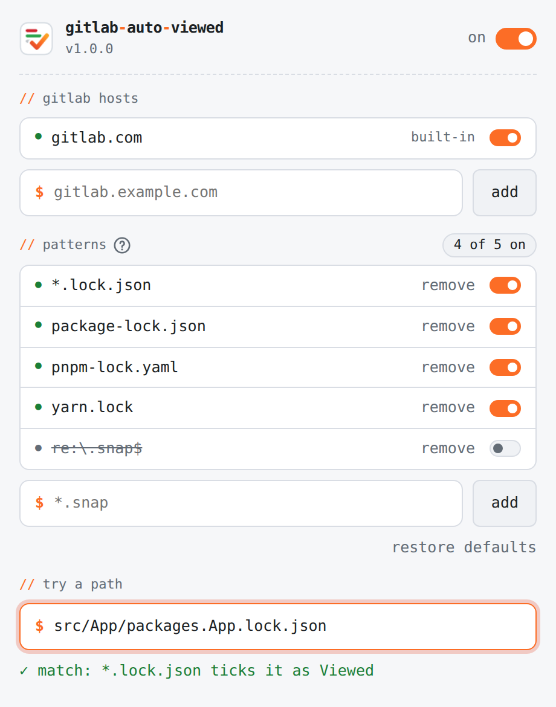

<p align="center">
  <picture>
    <source media="(prefers-color-scheme: dark)" srcset="src/icons/icon.svg">
    
  </picture>
</p>

<h1 align="center">GitLab Auto Viewed</h1>

<p align="center">
  A Chrome / Edge extension that ticks <b>Viewed</b> on merge request files you never need to read, lock files by default, so they collapse and drop out of the review.
</p>

<p align="center">
  <a href="https://github.com/yzhoholiev/gitlab-auto-viewed/actions/workflows/test.yml"></a>
  <a href="LICENSE"></a>
  
</p>

## ✨ Features

- Ticks **Viewed** on every file that matches your patterns: globs, `.gitignore`-style anchoring, folders or regular expressions.
- Each pattern has its own switch, so you can turn one off for a while without removing it.
- Works on `gitlab.com` out of the box, and on any self-hosted GitLab after one site-access prompt.
- Supports both diff UIs: the classic diffs view and Rapid Diffs.
- Never un-views a file. A file you untick by hand stays unticked while you review.
- One main switch plus a switch per host. The toolbar icon shows `off` while switched off.
- The popup and the toolbar icon follow the browser's light or dark mode.
- Stops all work once every matching file is ticked.

## 📦 Install

There is no store listing yet, so load the extension unpacked:

1. Get the code: `git clone https://github.com/yzhoholiev/gitlab-auto-viewed.git`, or **Code → Download ZIP** and unzip it.
2. Open `chrome://extensions` or `edge://extensions` and turn on **Developer mode**.
3. Press **Load unpacked** and select the `src` folder.
4. Pin the toolbar icon and open any merge request's **Changes** tab.

The browser runs whatever is checked out in that folder, so keep the clone on the `main` branch. Checking out another branch changes the extension on its next reload.

To update, run `git pull` on `main` or unzip a fresh download over the same folder, press **Reload** on the extension card, then refresh open merge request tabs. Tabs opened before the reload keep the old code.

> [!NOTE]
> Chrome on Windows and macOS warns about developer-mode extensions at start-up. A managed browser policy can block Developer mode entirely.

## 🎛️ The popup

<p align="center">
  <picture>
    <source media="(prefers-color-scheme: dark)" srcset="docs/popup-dark.png">
    
  </picture>
</p>

Click the toolbar icon to switch the extension or a host off, add a self-hosted GitLab, and manage patterns. Each pattern is a row with its own switch and a **remove** link, and new ones go in the box below the list. Every change saves at once and reruns open merge requests. **restore defaults** adds back any missing default lock-file pattern and leaves your own patterns as they are. **try a path** shows which pattern would tick a path, including one that is switched off.

## 🧩 Patterns

One pattern per row. The `?` next to **patterns** in the popup shows the same syntax.

| Line | Matches |
| --- | --- |
| `*.lock.json` | Glob on the file name |
| `*.{yml,yaml}` | Glob with alternatives, without `/` or nested `{}` inside them |
| `src/**/Migrations/*.Designer.cs` | Glob with a slash, matched against the full path |
| `/package-lock.json` | Leading slash anchors to the repository root |
| `vendor/` | Trailing slash: everything inside any `vendor` folder |
| `/vendor/` | Leading slash too: only the root `vendor` folder (as in `.gitignore`, a slash at the start or in the middle anchors the pattern) |
| `re:\.snap$` | Regular expression after `re:`, searched anywhere in the full path |

Patterns that would match every file, such as `*`, `**`, `/` or an empty `re:`, are rejected, and so are `[...]` character classes. An invalid pattern is not added, and the popup says why.

## 🏠 Self-hosted GitLab

Open the popup, type the instance's address (or paste any URL from it) under **gitlab hosts** and press **add**. The browser asks for access to that site only. Opening the popup on a self-hosted merge request pre-fills that site.

- Reload merge request tabs that were open before the host was added.
- Each host has its own switch, including `gitlab.com`. A switched-off host keeps its access, so switching it back on needs no new prompt and restarts open merge request pages on it.
- **remove**, or revoking site access in the browser's extension settings, stops the extension on that host for pages loaded afterwards. **remove** also clears the host's switch.
- Edge keeps a removed site listed under the extension's site access, with its toggle off. The access itself is gone: `(await chrome.permissions.getAll()).origins` in the popup's DevTools console lists only what the extension can still reach.

## ⚙️ How it works

- **One run per page.** A file is ticked at most once per run, so unticking one by hand sticks. Reloading the page, switching the extension or the host off and on, or changing the switched-on patterns starts a new run that ticks every matching file again.
- **Stops when done.** The file list comes from the page's own `diffs_metadata.json`, requested with the page's URL query. Once every matching file in it is ticked, the page stops watching.
- **Idle stop.** The page also stops after 10 minutes without a new file. That covers an Overview tab left open, a file list that cannot be read, and files that never render. The next scroll resumes it.
- **In-page navigation.** Opening the Changes tab or changing a diff filter restarts the page and refetches the file list. Hash-only changes, such as file-tree clicks, are ignored.
- **Lazy rendering.** The classic view renders only the files near the viewport, so files further down are ticked as you scroll to them.
- **Pushes.** GitLab resets **Viewed** when a later push changes a file, and the extension ticks it again on the next visit.
- **Theme.** Chrome and Edge have no manifest setting for theme-specific icons. On browser start and install, a hidden offscreen page reads `prefers-color-scheme` once and closes. After that, open merge request pages and the popup report changes, messaging the background only when the icon does not already match.

## ⚡ Performance

The content script is built to cost nothing once its work is done:

- It scans only `<input>` elements through a live collection, never the diff contents, and only after a DOM change, at most once per 250 ms. Each checkbox is processed once.
- It fetches `diffs_metadata.json` once, and only after diffs render, so the Overview, Commits and Pipelines views make no extra request.
- It disconnects its `MutationObserver` once every matching file is ticked. Between a DOM change and the scan it queues, the observer is disconnected too. A connected subtree observer makes Chrome build a record for every node Rapid Diffs streams in, which roughly doubled the parse time of 1,000 streamed files.
- Switched off, it does no scanning, observing or fetching.

## 🛠️ Development

| Path | Contents |
| --- | --- |
| `src/` | The extension, loaded unpacked as is. There is no build step. |
| `tests/` | Vitest unit suites run in happy-dom against a fake `chrome.*` API |
| `tests/e2e/` | Playwright suites that load `src/` into Chromium against a fake gitlab.com |

```sh
pnpm install
pnpm test               # unit tests
pnpm test:watch         # unit tests on every change
pnpm test:e2e:install   # once: download Playwright's Chromium
pnpm test:e2e           # browser tests, about 1 minute
```

The browser suites cover:

- **Behaviour** (`extension.spec.js`): both diff views, the popup, the off badge, and the toolbar icon in light and dark mode.
- **Switches** (`switches.spec.js`): the main switch overrides host switches, switching on reruns open merge requests, a host switched off and on reruns, adding a pattern or switching one on reruns, and nothing that is viewed is ever un-viewed. Self-hosted hosts need a permission prompt Playwright cannot answer, so the same rules are unit-tested in `content.test.js`.
- **Performance** (`performance.spec.js`): the V8 sampling profiler counts only time whose call stack passes through the extension's scripts. On a 400k-node diffs page the budgets are 100 ms for the first pass, 5 ms over 5 s once every file is ticked or while switched off, and 250 ms over 5 s on a 1,000-file merge request still waiting for a matching file to render. The first-pass and still-waiting budgets run in both diff views. Two more checks confirm the file list is requested once and only on the diffs view, and count the DOM change records the observer receives while files stream in, a measure that does not depend on machine speed.

The extension files are plain scripts rather than modules, so `tests/support/load-scripts.js` runs them in a fresh function scope per test with the fake `chrome` passed in. Keep `node_modules` out of `src/`: Chrome refuses to load an unpacked extension containing files whose names start with `_`.

Every push and pull request runs both suites in GitHub Actions. Dependabot proposes weekly dependency updates once a release is 7 days old.

## 📄 License

[MIT](LICENSE)
